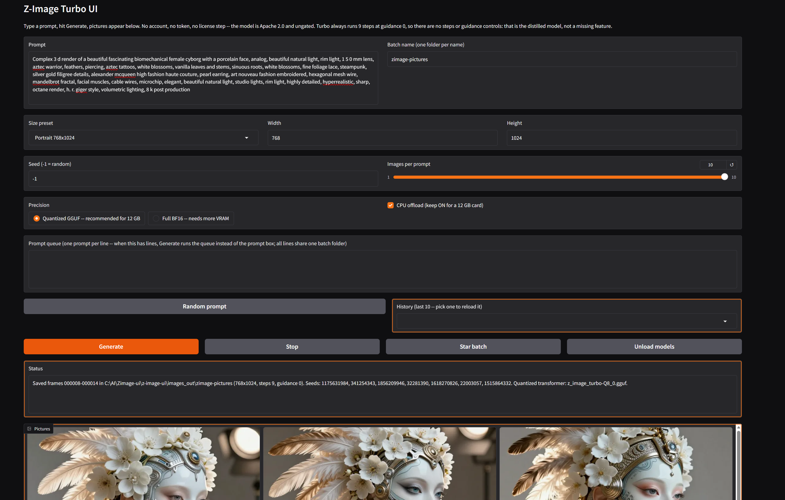
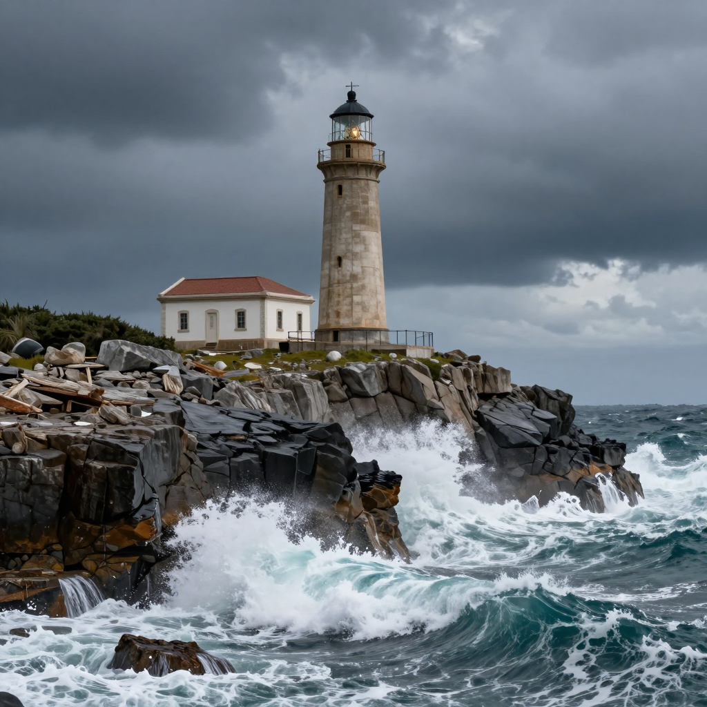
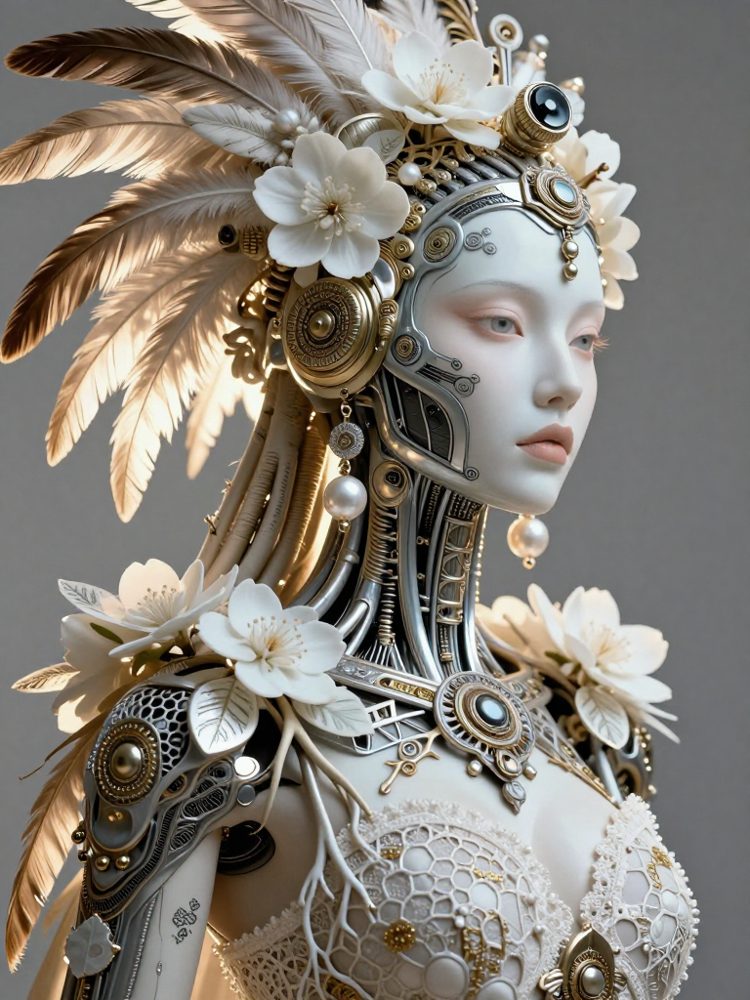

# Z-Image Turbo UI
Easiest install: grab the bundled zip from the Releases tab — no Python setup needed.

## Before you start

- A Windows PC with Python 3.12 installed first from python.org — tick "Add python.exe to PATH" during install. This app uses `py -3.12`, not 3.10.
- An NVIDIA graphics card (12 GB is plenty), about 20 GB free disk space, and an internet connection.
- The first Generate downloads about 15 GB of model weights on the default quantized path (about 20 GB if you switch to full BF16).
- No token, no account, no license acceptance. Z-Image Turbo is Apache 2.0 and ungated — the first download just works.

**Z-Image Turbo, without Jupyter and without Colab.**

Z-Image Turbo is Tongyi-MAI's (Alibaba) 6B distilled image model: 8 sampling steps, strong photorealistic quality, and accurate English and Chinese text in pictures. This is a plain app: run it, a page opens in your browser, type a prompt, pictures appear. Built in the same shape as Kandinsky UI and Sana UI, free forever.

*The Z-Image UI with a generated image in it.*

*Example render — lighthouse.*

*Example render — biomechanical cyborg, portrait.*

## What it does

- Text-to-image generation on your own GPU -- no cloud, no account
- Turbo always runs 9 inference steps (8 DiT forwards) at guidance 0 -- there are deliberately no steps or guidance controls, because the distilled model has no use for them
- Quantization: a GGUF transformer by default (the loader picks the best quant the GGUF repo actually offers, Q8_0 first down to the verified Q3_K_M file), plus a CPU offload toggle (default ON) -- together those are what make this fit comfortably on 12 GB
- Full BF16 as a choice for bigger cards (on a 12 GB card it only works with offload ON, and even then it is tight -- it is not the default for a reason)
- Size presets (Square 1024, Portrait 768x1024, Landscape 1024x768, Small square 768) plus custom width/height boxes, up to 2048
- Up to 10 pictures per prompt, each with its own seed, saved as 000001.png, 000002.png, and so on
- Seed shown in the status line (-1 = random; a fixed seed S gives S, S+1, S+2, ... across a multi-image run)
- A Random prompt button (word banks built in, no list file), and a session-only prompt history dropdown
- A Stop button to cancel a run, and Star batch to copy a batch into images_out/favorites/
- A prompt queue (one prompt per line -- when it has lines, Generate runs the queue instead of the single prompt box, all lines sharing the one batch folder, frames numbered continuously)
- Dynamic prompts: {a|b|c} groups, one random pick per group, re-expanded for every single image. settings.txt records the expanded prompt actually used
- An Unload models button to free VRAM and RAM
- Every run adds its pictures to the batch folder and appends a block to `settings.txt` next to them (date, time, frame range, settings, prompt, expanded prompts, seeds)

No animation, no upscaling, no editing, no ControlNet, no inpainting, no img2img -- v1 is text-to-image only, kept simple on purpose.

## Requirements

- Windows, an NVIDIA GPU (12 GB is plenty), and a recent driver
- Python 3.12, with "Add python.exe to PATH" ticked. This is NOT optional and NOT the Python your other apps use: Diffusers 0.42 dropped Python 3.10, so this app needs 3.12. Install 3.12 side by side -- your Python 3.10 install is left completely alone, and this app lives entirely in its own `.venv` built from 3.12
- Disk space: about 20 GB free for the first download (about 15 GB on the default quantized path), plus room for pictures
- System RAM: 16 GB is fine -- the quantized transformer is 4-7 GB and the text encoder stays on CPU except while encoding, so nothing like the 20 GB pileup that sank heavier models

## Install

1. Install Python 3.12 from python.org (tick "Add python.exe to PATH"). If you already have another Python, this sits alongside it -- nothing existing is changed.
2. Double-click `install.bat` and wait -- it builds a Python 3.12 virtual environment and installs PyTorch with CUDA plus the packages. Run it again if anything interrupts it; it resumes where it stopped.
3. Double-click `run.bat`. A page opens in your browser. Type a prompt and hit Generate.

install.bat does NOT need re-running for code-only updates: if only app.py changed, just replace the file and run run.bat again.

## First test

1. Leave everything at the defaults and hit Generate: 1024x1024, quantized GGUF, offload on.
2. The first run downloads the models (about 15 GB), so it takes a while -- that is the one-time download, not a stuck render. After that, repeat runs are just the render: Turbo is 8 steps, so pictures come out in seconds.
3. The status line says which quantized transformer loaded (for example `Quantized transformer: z_image_turbo-Q8_0.gguf.`). If it ever says the quantized load failed and it fell back to BF16 with offload, that is the honest answer, not a bug to work around by hand.
4. If a run fails with an out-of-memory error: make sure offload is ON and precision is the quantized default. Full BF16 with offload OFF will not fit on a 12 GB card -- that combination is for bigger cards only.

## Where pictures go

`images_out/` next to `run.bat`, one subfolder per batch name, reused across runs -- repeat runs with the same batch name add pictures to the same folder, numbered continuously (`000001.png`, `000002.png`, ...), so nothing is ever overwritten. `settings.txt` in the folder grows by one block per run (date, time, frame range, prompt, expanded prompts, size, steps, guidance, seeds, precision, offload). Starred batches land in `images_out/favorites/`.

## How it works

Diffusers 0.42.0, ZImagePipeline:

1. `ZImagePipeline.from_pretrained` loads the Z-Image Turbo repo (Qwen3-4B text encoder + VAE), except the transformer, which is replaced by a quantized GGUF transformer loaded with `ZImageTransformer2DModel.from_single_file` + `GGUFQuantizationConfig` (compute in bfloat16). The quant file is picked at load time from the GGUF repo's actual file listing, best first (Q8_0, Q6_K, Q5_K_M, Q4_K_M, Q3_K_M) -- a filename is never wired in blind.
2. With offload ON (the default), `enable_model_cpu_offload()` keeps the text encoder on CPU except while encoding and moves the transformer to GPU for diffusion. With offload OFF, everything goes to GPU with `.to("cuda")` -- only for cards bigger than 12 GB.
3. The pipeline call is `pipe(prompt, height, width, num_inference_steps=9, guidance_scale=0.0, generator)` with one CPU generator per image (seeded from the seed box), following the model card's own snippet. The CPU generator is deliberate: it works identically with offload on or off.

Notes and known limits of this build:

- The exact quantized file depends on what the GGUF repo offers on the day you install: the status line always names the file that actually loaded, so there is no guessing.
- The quantized GGUF path is the tested default. The full-BF16 fallback did complete a first picture on the author's 12 GB card, but a following BF16 run ran out of memory -- on 12 GB, stay on the quantized default with offload ON.
- Proven on the author's own PC (RTX 4070 12 GB, 16 GB RAM) on Oct 27, 2026: real install, first download, first picture, the quantized Q8_0 path, prompt queues, and a full 10-image portrait batch. Memory is freed between images in a run, which is what makes longer queues work.

## Code verification

- `app.py` compiles clean (`py_compile`).
- The loader paths are stub-tested with fake pipeline modules: quantized-load path, GGUF file-picker preference order and fallback, BF16-fallback path with offload forced on, guidance lock (every pipeline call passes 0.0), batch-folder/settings logic (continuous 6-digit frames, appended settings blocks), dynamics expansion, seed resolution, and the early-exit paths. The stub test is not shipped in the zip.
- Real-world proof is separate from the stub tests, and is listed above: install, download, and generation were all run on a real 12 GB Windows PC.

## Models and permissions

The model belongs to Tongyi-MAI (Alibaba) -- see its Hugging Face page for terms. Z-Image Turbo is Apache 2.0, ungated, free for personal and commercial use. The GGUF quants are community conversions of the same weights under the same license. Nothing is bundled here and nothing is sold. This UI (the Gradio app, the wrapper, the installer) is by Alan Carmack.

## License

MIT for this UI code -- free to use, share, and change.
